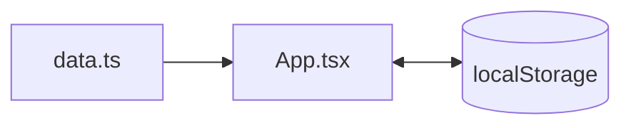

# MaxFit

Трекер тренировок на неделю: зал и бассейн по дням, упражнения для осанки каждый день, отметки о выполнении и прогресс дня. Прогресс сохраняется в браузере.


## Программа

| День | Тренировка |
|---|---|
| ПН | Зал A |
| ВТ | Бассейн |
| СР | Зал B |
| ЧТ | Бассейн |
| ПТ | Зал A |
| СБ | Бассейн |
| ВС | Восстановление |

Плюс два упражнения для осанки каждый день.

## Возможности

- Выбор дня недели, список упражнений с подходами, отдыхом и заметками
- Ссылки на видео с техникой выполнения
- Отметка «выполнено» и прогресс-бар дня
- Сохранение в `localStorage`, сброс дня одной кнопкой
- Адаптивная вёрстка и базовая доступность (ARIA)

## Карта проекта

```
maxfit/
└── src/
    ├── App.tsx      # Интерфейс: выбор дня, карточки, прогресс
    ├── data.ts      # Программа тренировок на неделю
    ├── types.ts     # Типы: Exercise, PoolExercise, PostureExercise, DayPlan
    └── index.css    # Tailwind и базовые стили
```



## Запуск

```bash
npm install
npm run dev
```

Упражнения собраны по мотивам [exercises-dataset](https://github.com/hasaneyldrm/exercises-dataset).
